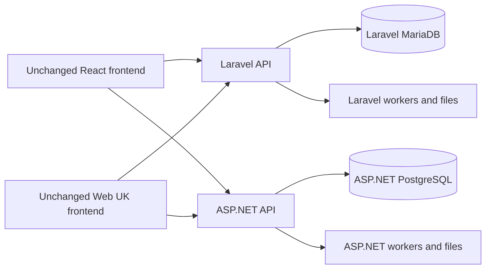

# Dual backend architecture for independent new installations

Last reviewed:2026-10-25. The owner clarified that **new installations must work on either backend with both web frontends unchanged**. Laravel remains supported. Existing-community data transfer, a shared live database and simultaneous cross-engine synchronization are not part of this stage. Fresh database, first tenant/admin, configuration, workers, media, install/recovery and all required current client workflows are included. Audit and planning are authorized; implementation remains paused.

## Required runtime arrangement

The arrows describe selectable supported combinations, not simultaneous dual writes. Each installation chooses its backend and owns its data/worker/storage lifecycle. Different internal schemas are acceptable. No live cross-engine database synchronization or existing-community conversion is part of this stage.

| Component | Source | Selection/contract |
| --- | --- | --- |
| React application, including admin | react-frontend/ | Existing VITE_BACKEND_TARGET and API base configuration; no page/component branch or fork |
| Web UK accessible BFF/frontend | web-uk/ | ACCESSIBLE_BACKEND_TARGET and API base configuration; same routes/forms/templates |
| Laravel | root app/, routes/, database/ | Current consumed behavior and operational reference; remains supported |
| ASP.NET | aspnet-backend/src/ | Equivalent methods/payloads, headers/cookies, roles/tenants, values/errors, stored state and effects |

The .NET solution compiles; that does not make the implementation equivalent. Existing alias/compatibility layers contain collisions, false-success dispatch and semantic gaps. Preserve real services where they work, assign each route/domain a single owner, and replace success-shaped fallbacks with completed behavior or an explicit unsupported result while the package remains open.

## Required supporting systems

Fresh schema/tenant/admin bootstrap, first-run settings/reference data, session lifecycle, durable workers, message events, assets/media and provider callbacks are part of a functioning new install. A seeded development database is not a supported production bootstrap. Both API and worker settings must be observable; a persisted flag without a consumer is not a working setting.

Domain behavior belongs in owned services. Shared transport/outbox/claim/retry infrastructure must preserve each feature’s state machine, permissions, recipient preferences and localized outcomes. No universal response-shape heuristic can replace the actual caller contract.

## Validation boundary

Use deterministic synthetic logical fixtures in separate stores. Normalize incidental IDs/timestamps, not balances, permissions, state, cursor termination or effects. Test all four frontend/backend combinations. Migration replay, restart/recovery and DB+asset restore are required release evidence; current source inventory and offline SQL generation do not satisfy them.

See [roadmap and effort](ROADMAP.md), [current findings](CURRENT_ASPNET_CONTRACT_STATUS.md), [API method](API_PARITY.md) and [frontend contract](FRONTEND_PARITY.md). Delivery remains paused.
